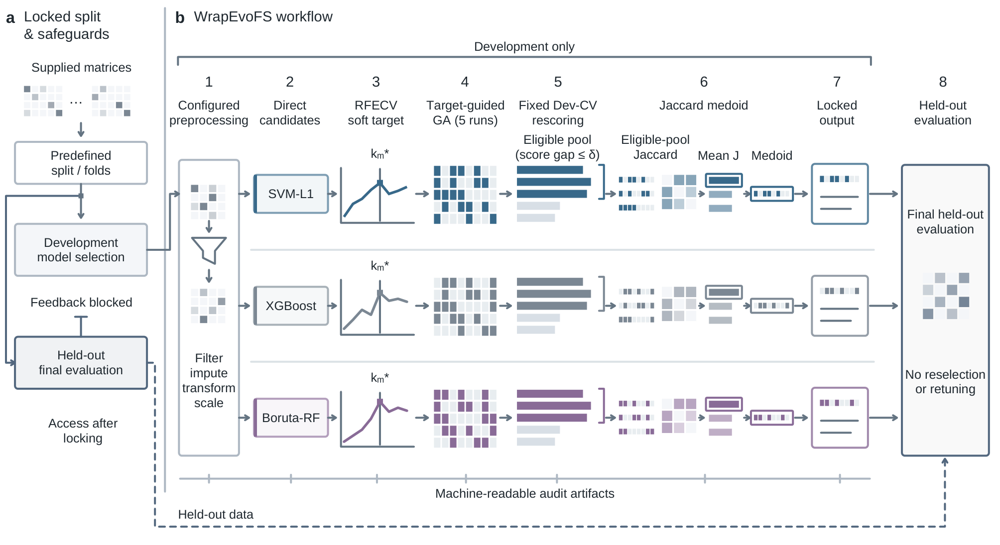

# WrapEvoFS

[](https://pypi.org/project/wrapevofs/)
[](https://pypi.org/project/wrapevofs/)
[](https://github.com/junseoparkX/wrapevofs-package/actions/workflows/ci.yml)
[](LICENSE)

WrapEvoFS is a Python package for auditable stochastic feature compression. It combines branch-specific screening, RFECV-derived size guidance, repeated genetic searches, and deterministic regret-constrained representative locking for binary or multiclass tabular classification. Selection and locking use development data only; held-out outcomes are not inputs to the locking decision.

[](https://github.com/junseoparkX/wrapevofs-package/blob/main/.github/assets/figure-1-workflow.pdf)

**Figure 1.** Development-only feature selection and representative locking, followed by held-out evaluation. The diagram shows the reference workflow; optional multi-bank tolerance calibration is described below. Click the figure for the original vector PDF.

## Key features

- corrected untruncated genetic-search objective with separate nonnegative sampling weights;
- absolute, relative, and best-run-SE-scaled empirical regret modes;
- Jaccard-medoid locking within the eligible candidate pool;
- opt-in multi-bank development-only tolerance calibration over observed score gaps;
- canonical feature-mask encoding and deterministic SHA-256 tie ordering;
- complete candidate, regret, agreement, seed, and configuration audits;
- checkpoint/resume support and explicit legacy-compatible modes;
- CPU execution, with optional supported GPU backends where available.

## Installation

WrapEvoFS supports Python 3.10–3.12. Install the latest public release from
[PyPI](https://pypi.org/project/wrapevofs/):

```bash
python -m pip install wrapevofs
```

For an exact installation with the opt-in calibration API:

```bash
python -m pip install wrapevofs==0.3.0
```

The earlier reference release remains available for reproducing archived analyses:

```bash
python -m pip install wrapevofs==0.2.0
```

For development from a source checkout:

```bash
git clone https://github.com/junseoparkX/wrapevofs-package.git
cd wrapevofs-package
python -m venv .venv
python -m pip install --upgrade pip
python -m pip install -e .
```

Install development tools or optional selectors with:

```bash
python -m pip install -e ".[dev]"
python -m pip install -e ".[all]"
```

## Python API

```python
import pandas as pd

from wrapevofs import PipelineConfig, WrapEvoPipeline
from wrapevofs.artifacts import save_pipeline_result

data = pd.read_csv("examples/sample_radiomics.csv")
config = PipelineConfig.from_yaml("configs/synthetic_regret_smoke.yaml")
result = WrapEvoPipeline(config).run_full(
    data,
    target_column="MGMT_binary",
    drop_columns=["patient_id"],
    methods=["svm_l1"],
)
save_pipeline_result(result, "runs/api_smoke")
```

The bundled CSV is synthetic and contains no participant data.

## Command line

```bash
wrapevofs run \
  --csv examples/sample_radiomics.csv \
  --target MGMT_binary \
  --drop-columns patient_id \
  --out runs/cli_smoke \
  --config configs/synthetic_regret_smoke.yaml \
  --run-ga
```

Run `wrapevofs run --help` for the complete interface.
Use `wrapevofs --version` to report the installed package version. A run with a
matching atomic GA state can be continued by repeating its original command
with `--resume`; mismatched or corrupt states are rejected rather than silently
starting a new search.

## Regret-constrained representative locking

For larger-is-better development scores, candidate regret is the gap from the highest candidate score. The recommended absolute rule first retains only candidates with regret at most the configured tolerance, then selects the candidate with greatest mean Jaccard similarity to the eligible pool. Ties are resolved by higher locking score, smaller feature count, and the stable hash of the canonical mask. The selected candidate therefore always satisfies the configured empirical score-gap constraint. This is an empirical development-score guarantee, not a guarantee of expected predictive risk or external validity.

See [`configs/recommended_regret_constrained.yaml`](configs/recommended_regret_constrained.yaml) for the recommended new-analysis settings. Archived configurations preserve the legacy zero-truncated objective and top-k medoid behavior when those modes are selected.

## Reproducibility and audit outputs

### Optional multi-bank tolerance calibration

Version 0.3.0 adds `calibrate_tolerance(banks, *, delta_grid=None, fold_ids=None)`.
It accepts only candidate feature sets, development scores and aligned development
fold vectors (plus provenance labels). It searches zero and all observed
within-bank score gaps, applies a development-fold SE heuristic, and maximizes
fitted cross-bank Jaccard with deterministic ties. An explicit `delta_grid`
supports grid comparisons. Existing pipeline settings, reference defaults, and
single-bank locking are unchanged; calibration runs only when called explicitly.

```python
from wrapevofs import LockingCandidate, calibrate_tolerance

banks = {
    "bank_a": [LockingCandidate(0, ["a", "b"], 0.90, [0.88, 0.92])],
    "bank_b": [LockingCandidate(0, ["a", "c"], 0.89, [0.87, 0.91])],
}
fitted = calibrate_tolerance(banks, fold_ids=["split_0", "split_1"])
print(fitted.selected_delta)
print(fitted.curve)
```

All fold vectors must refer to the same splits in the same order. The SE filter
is a training heuristic, with no generalization or noninferiority guarantee.
Fitted-bank overlap is an optimization objective and requires separate validation.
The retrospective motivating analysis was designed after earlier held-out
comparisons and does not establish improved AUROC. See
[`docs/TOLERANCE_CALIBRATION.md`](docs/TOLERANCE_CALIBRATION.md) for the exact rule,
input validation, audits, and the limits of that exploratory evidence. Run
`python examples/toy_tolerance_calibration.py` for a synthetic example.

Locking exports a candidate audit, eligible-pool Jaccard matrix, selected features, and summary metadata under `locking/<branch>/`. The audit records canonical masks, stable hashes, duplicate multiplicity, scores, regrets, eligibility, agreement, seeds, metric orientation, and configuration hashes. Details are in [`docs/ARTIFACT_SCHEMA.md`](docs/ARTIFACT_SCHEMA.md), [`docs/CHECKPOINT_RESUME.md`](docs/CHECKPOINT_RESUME.md), and [`REPRODUCIBILITY.md`](REPRODUCIBILITY.md).

## Testing

```bash
python -m pytest -q
python scripts/run_development_only_smoke.py
```

The continuous-integration workflow tests Python 3.10, 3.11, and 3.12, builds the wheel and source distribution, checks package metadata, and performs clean-install API and CLI smoke tests.

## Citation

Citation metadata are provided in [`CITATION.cff`](CITATION.cff). Please cite the associated manuscript when it becomes available.

## License

WrapEvoFS is distributed under the [BSD 3-Clause License](LICENSE).
